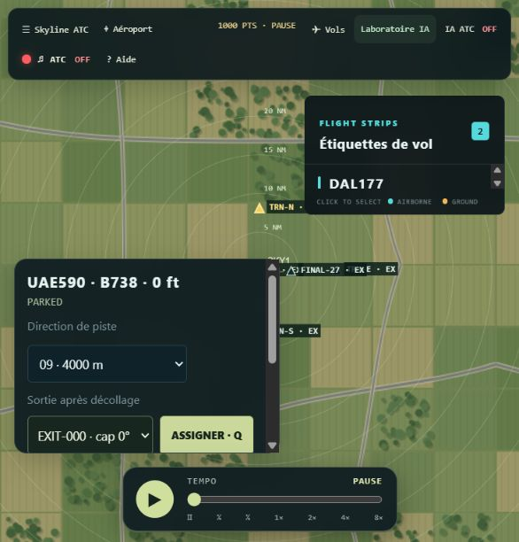
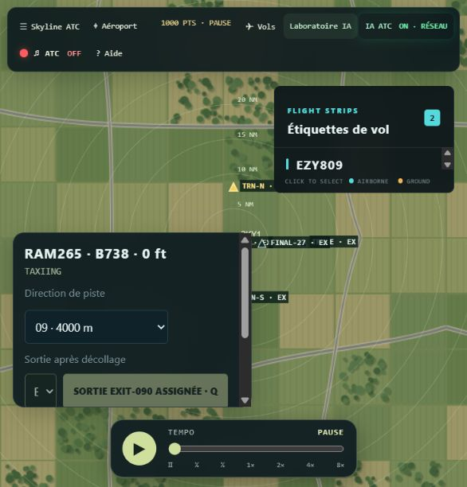
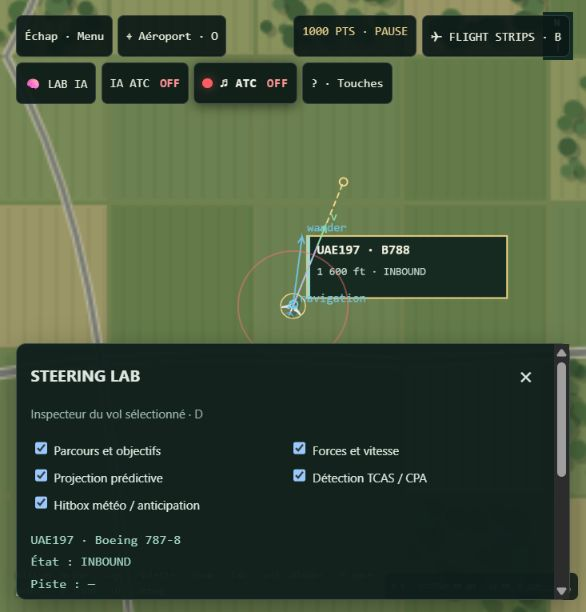
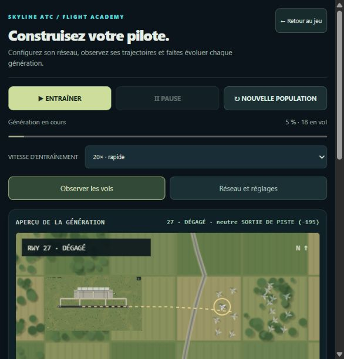

# SkylineATC — Vector Approach

SkylineATC est un jeu solo de contrôle aérien en vue top-down. Le joueur gère les arrivées, les départs, le roulage, les urgences et la séparation du trafic autour d’aéroports détaillés, à l’aide de la souris ou du clavier.

Le projet est développé en JavaScript ES2022 avec p5.js. Il fonctionne directement dans un navigateur moderne, sans bundler ni installation npm obligatoire.



🎬 [Voir la vidéo complète de démonstration](assets/demo/skylineatc-demo.mp4) — 1 min 26 s, sous-titres français.

## Le point essentiel : tout repose sur `vehicle.js`

Le socle du projet est le `Vehicle` fourni dans [`vehicle.js`](vehicle.js). Ce fichier est la base locomotrice de l’ensemble de la simulation et il est volontairement **protégé et inchangé**.

Les entités mobiles spécialisées héritent de cette base :

```text
Vehicle                         vehicle.js, base Newtonienne
├── Airplane                    avion contrôlé et simulé
│   ├── ModelAircraft            silhouette et performances d’un modèle
│   │   └── Helicopter            station et opérations hélicoptère
│   ├── Airliner                 trafic commercial
│   ├── RegionalJet              trafic régional
│   └── FighterJet               interception militaire
├── EmergencyVehicle             véhicules incendie et secours
└── StormCell                    cellule orageuse mobile
```

Les sous-classes calculent les forces de direction puis réutilisent la locomotion héritée. Les positions ne sont pas téléportées pendant la simulation : le mouvement résulte de forces bornées, de la vitesse et de l’intégration de `Vehicle`.

## Fonctionnalités actuelles

- modes Libre, Missions, Urgences et Aéroport ;
- quatre plateformes manuelles et un aéroport d’entraînement ;
- géométrie d’aéroport détaillée : pistes, taxiways, lignes d’attente, parkings, bâtiments, végétation, routes et alentours ;
- carte nord en haut, zoom secteur/aéroport et déplacement dans un espace aérien étendu ;
- avions B738, B788, A388, jets régionaux, hélicoptères et chasseurs avec silhouettes distinctes ;
- trafic entrant depuis les bords de la carte, arrivées, finales, atterrissages et remises de gaz ;
- départs avec repoussage, file de roulage, traversées de piste, hold short, line-up, décollage et sortie de secteur ;
- affectation de piste, cap, altitude par paliers, point de navigation, holding et sortie de secteur ;
- flight strips, étiquettes radar, fiche d’avion sélectionné et commandes souris ;
- audio ATC et alertes TCAS/RA avec initialisation après interaction utilisateur ;
- collisions détectées physiquement, effet d’explosion, pénalité et gestion distincte Libre/Mission ;
- orages avec zone d’obstacle invisible et déviation par steering ;
- interception militaire déclenchée par le contrôleur : approche, escorte latérale, remise des gaz et sortie ;
- mode IA ATC qui peut prendre la gestion des avions à la place du joueur ;
- laboratoire d’entraînement, réseau neuronal configurable, neuroévolution, scores, activations et export JSON ;
- menu Debug dédié aux démonstrations : forces, projections, TCAS, obstacles, scénarios de collision, météo et spawn d’avions ;
- tutoriel interactif, pause et vitesse de simulation réglable.



## Steering Behaviors implémentés

Les comportements de Craig W. Reynolds sont utilisés comme forces de direction, puis combinés par `SteeringComposer` avant l’intégration de l’avion.

| Comportement | Utilisation dans SkylineATC |
| --- | --- |
| **Seek** | Rejoindre une cible, un point de navigation ou la position d’interception. |
| **Arrival** | Ralentir progressivement vers un stand, un point d’arrêt, un seuil ou une zone de capture. |
| **Path Following** | Suivre une route de taxi, un axe de piste, une finale ou un circuit d’attente par projection scalaire. |
| **Separation** | Écarter les trafics proches avec prédiction du CPA et filtrage par altitude. |
| **Obstacle Avoidance** | Dévier autour des cellules orageuses et obstacles projetés dans le couloir de vol. |
| **Wander** | Donner une dérive organique aux entrants sans clairance et aux cellules météo. |
| **Pursuit** | Prédire la position d’un avion civil pour l’interception militaire. |
| **Offset pursuit / velocity matching** | Maintenir le chasseur à côté de l’avion escorté. |
| **Leader Following / Chaining** | Respecter les files de roulage et les espacements au sol. |
| **Braking** | Freiner avant une attente, un arrêt, un rejet de décollage ou une sortie. |
| **Evasion / Flee** | Comportement disponible pour les scénarios d’évitement et les démonstrations. |

Le TCAS et la collision ne déplacent pas directement les avions : ils produisent des forces d’évitement et utilisent les dimensions physiques des appareils. Une collision réelle exige un contact horizontal et un écart vertical compatible ; le simple chevauchement visuel d’étiquettes n’est pas une collision.



## IA ATC

L’IA jouable est maintenant orientée **contrôle aérien**, et non plus vers un cerveau autonome par avion. Lorsqu’elle est activée, le contrôleur automatique prend les décisions opérationnelles à la place du joueur : affectation des pistes, vecteurs, altitude, holding, taxi, départs et sorties.

Le laboratoire IA sert à entraîner et inspecter les politiques de steering utilisées par la simulation. Le réseau neuronal est écrit en JavaScript pur, sans TensorFlow.js : ses hyperparamètres, ses activations, sa population, ses mutations et son élitisme sont observables et exportables.



Cette IA reste un système expérimental de jeu. Elle ne prétend pas reproduire une certification ATC réelle ni les procédures publiées SID/STAR.

## Prise en main

### Lancer localement

Depuis le dossier du projet, utiliser un serveur HTTP statique :

```bash
python -m http.server 5500
```

Puis ouvrir `http://127.0.0.1:5500/index.html`.

Un serveur HTTP est recommandé pour garantir le chargement des scripts, des données GeoJSON et des assets. Aucun `npm install` ni étape de compilation n’est nécessaire.

### Contrôles principaux

- clic sur un avion ou un flight strip : sélectionner un trafic ;
- glisser depuis un avion : assigner un cap ;
- commandes de la fiche sélectionnée : piste, altitude, sortie, taxi, approche et holding ;
- molette ou boutons de zoom : passer de la vue secteur à la vue aéroport ;
- `Espace` : pause/reprise ;
- `D` : ouvrir l’inspecteur Debug ;
- `H` : ouvrir l’aide clavier interactive ;
- `N` : générer un trafic entrant de test ;
- `Tab` : parcourir les avions visibles ;
- touches de vitesse : ralentir, accélérer ou revenir au temps normal.

Les actions de jeu usuelles sont accessibles à la souris. Le clavier est un complément rapide, pas une obligation.

## Vérification avant publication

La suite automatisée couvre les forces, les bornes physiques, les projections, les altitudes, le TCAS, les collisions, les comportements, les modèles d’avions, les aéroports, l’IA et l’intégrité de `vehicle.js`.

```bash
node --test tests/*.test.mjs
```

La vérification attendue est : zéro test en échec. L’empreinte actuelle de `vehicle.js` est contrôlée par les tests afin d’éviter toute modification accidentelle du socle fourni.

## Organisation du code

```text
vehicle.js          base Vehicle protégée
core/               simulation, composition et comportements génériques
entities/           avions, modèles, hélicoptère, secours, météo
systems/            taxi, pistes, approche, trafic, urgences, IA ATC
airports/           catalogues et plateformes
data/               navigation, GeoJSON et données d’aéroport
ai/                 réseau neuronal, politique ATC et neuroévolution
ui/                 HUD, radar, labels, tutoriel et debug
tests/              tests Node.js sans dépendance externe
assets/             textures et captures du projet
```

## Limites connues

SkylineATC est une simulation de jeu avec temps et vitesses compressés. Les aéroports et procédures sont inspirés de données géographiques et de pratiques ATC, mais les STAR/SID réelles ne sont pas reproduites. Le projet n’est pas un outil de formation certifié.

Il n’y a pas encore de multijoueur. Les visuels sont des rendus top-down originaux : les silhouettes différencient les modèles mais ne constituent pas des modèles 3D ou des livrées commerciales sous licence. L’audio est généré localement et pourra être enrichi plus tard.

## Suite prévue

- améliorer la finition graphique des avions, véhicules et bâtiments ;
- enrichir les missions, objectifs, difficultés et écrans de fin ;
- renforcer l’évaluation de l’IA ATC sur des missions complètes ;
- ajouter sauvegarde/reprise et réglages persistants ;
- améliorer la phraséologie et le mixage audio ;
- ajouter une CI qui lance automatiquement les tests à chaque publication.

## Crédits et inspiration

Projet pédagogique consacré aux Steering Behaviors, à la simulation ATC et à l’IA. L’ambition d’un HUD de jeu lisible et d’un laboratoire IA visible, tandis que la locomotion du projet repose sur le `Vehicle` fourni et protégé dans ce dépôt.

